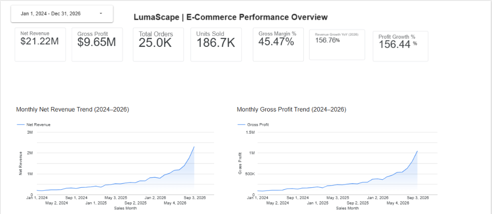
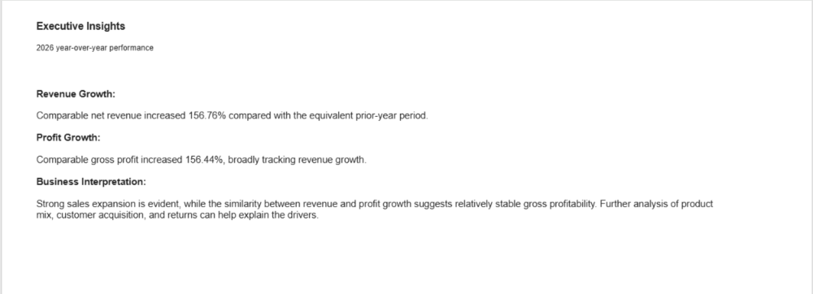
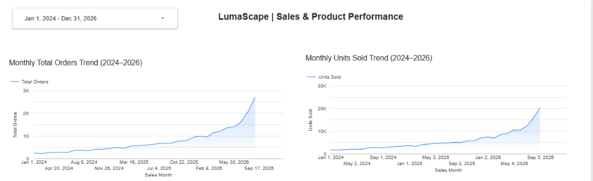
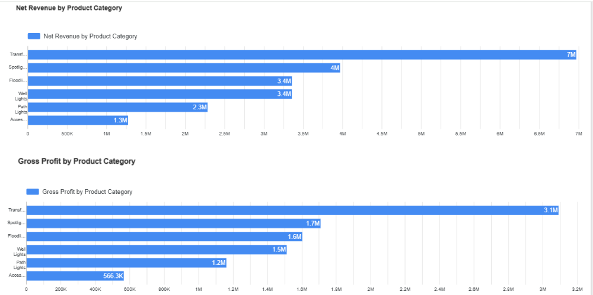
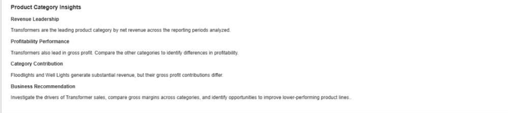
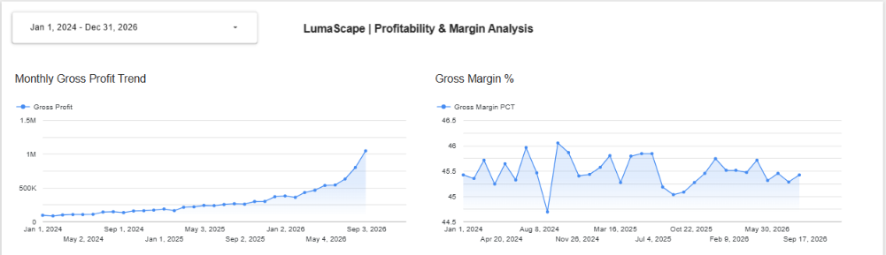
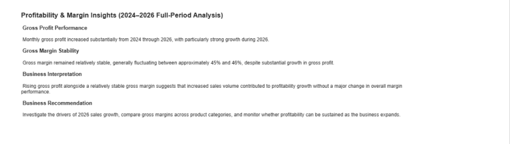

# LumaScape | E-Commerce Executive Dashboard

**End-to-End Business Intelligence & Data Analytics Portfolio Project**

**Technologies:** Google Cloud BigQuery | SQL | Looker Studio | GitHub

**Reporting Period:** January 2024 – Available 2026 Data

---

## 1. Dashboard Overview

LumaScape is an end-to-end e-commerce business intelligence portfolio project using Google BigQuery, SQL, and Looker Studio.

The project analyzes e-commerce performance across 2024–2026, focusing on:

- Net revenue and gross profit
- Total orders and units sold
- Gross margin performance
- Product category performance
- Monthly sales trends
- Year-over-year revenue and profit growth

The objective is to transform transactional data into meaningful business intelligence that supports management decisions.

---

## 2. Technology Stack

| Technology | Purpose |
|---|---|
| Google Cloud BigQuery | Cloud data storage and analytical processing |
| SQL | Data transformation, reporting views, and KPI calculations |
| Looker Studio | Interactive dashboards and data visualization |
| GitHub | Source code, documentation, and version control |

### Data Analytics Architecture

E-Commerce Source Data  
↓  
Google BigQuery Tables  
↓  
SQL Reporting Views  
↓  
Looker Studio Dashboards  
↓  
Business Insights and Recommendations

---

## 3. Executive KPI Framework

The dashboard monitors seven executive performance indicators.

| KPI | Business Purpose |
|---|---|
| Net Revenue | Measures sales revenue after applicable adjustments |
| Gross Profit | Measures revenue remaining after cost of goods sold |
| Total Orders | Tracks sales transaction volume |
| Units Sold | Measures product sales volume |
| Gross Margin % | Evaluates gross profitability relative to revenue |
| Revenue Growth YoY % | Compares revenue against the equivalent prior-year period |
| Profit Growth YoY % | Compares gross profit against the equivalent prior-year period |

### Executive Dashboard Results

The dashboard overview displays the following results for its selected reporting range.

| Metric | Dashboard Value |
|---|---:|
| Net Revenue | $21.22M |
| Gross Profit | $9.65M |
| Total Orders | 25.0K |
| Units Sold | 186.7K |
| Gross Margin | 45.47% |
| Comparable Revenue Growth YoY | 156.76% |
| Comparable Profit Growth YoY | 156.44% |

**Reporting note:** These figures reflect the dashboard selection shown in the portfolio screenshot. Year-over-year metrics compare equivalent reporting periods rather than necessarily representing full calendar-year growth.

---

## 4. Page 1 — Executive Performance Overview

### Business Objective

Provide management with a high-level overview of revenue, profitability, sales activity, and business growth.

### Key Visualizations

- Executive KPI scorecards
- Monthly Net Revenue Trend (2024–2026)
- Monthly Gross Profit Trend (2024–2026)
- Executive Business Insights

### Business Questions

1. How much revenue and gross profit is the business generating?
2. How are revenue and profitability changing over time?
3. How does current-year performance compare with the equivalent prior-year period?
4. Is profitability growing at a similar rate to revenue?

### Executive Performance Dashboard

### Executive Business Insights

### Key Findings

- Comparable net revenue increased 156.76% year over year.
- Comparable gross profit increased 156.44% year over year.
- Revenue and gross profit growth rates were closely aligned.
- The growth pattern suggests business expansion while overall gross profitability remained relatively stable.

### Management Interpretation

The business experienced substantial growth in both revenue and gross profit.

Because the two growth rates are similar, further analysis should examine whether sales volume, product mix, pricing, or other operating factors explain the expansion.

---

## 5. Page 2 — Sales & Product Performance

### Business Objective

Analyze sales activity and identify the product categories contributing most to overall business performance.

### Key Visualizations

- Monthly Total Orders Trend
- Monthly Units Sold Trend
- Net Revenue by Product Category
- Gross Profit by Product Category
- Product Category Insights

### Business Questions

1. Which product categories generate the highest revenue?
2. Which product categories contribute the most gross profit?
3. How are orders and units sold changing over time?
4. Which product lines require additional management attention?

### Sales and Product Performance Dashboard

### Product Category Revenue and Profitability

### Product Category Business Insights

### Key Findings

- Transformers are the leading product category by net revenue.
- Transformers also contribute the highest gross profit.
- Floodlights and Well Lights generate substantial revenue.
- Product categories differ in their overall revenue and gross profit contributions.
- Monthly orders and units sold increased substantially during the reporting period.

### Management Interpretation

Transformers represent an important product category for the business.

Management should investigate the factors contributing to Transformer sales and evaluate category-level gross margins to identify opportunities for improving profitability.

Additional attention should be given to lower-performing product categories.

---

## 6. Page 3 — Profitability & Margin Analysis

### Business Objective

Evaluate gross profit growth and determine whether overall gross margin remains stable as sales expand.

### Key Visualizations

- Monthly Gross Profit Trend
- Gross Margin %
- Profitability and Margin Insights

### Business Questions

1. Is gross profit increasing?
2. Is gross margin stable as revenue grows?
3. Is profitability growth associated with higher sales volume or changes in margin?
4. Can the business sustain its current profitability performance?

### Profitability and Margin Dashboard

### Profitability and Margin Insights

### Key Findings

- Monthly gross profit increased substantially from 2024 through 2026.
- Growth accelerated during 2026.
- Gross margin generally fluctuated around 45%–46%.
- Gross profit increased without a major sustained change in overall gross margin.

### Management Interpretation

The combination of increasing gross profit and relatively stable gross margin is consistent with sales expansion contributing to higher gross profit.

Additional analysis of transaction volumes, pricing, product mix, and costs would be required to establish the underlying drivers.

---

## 7. Dashboard Screenshot Gallery

The following seven screenshots document the three-page LumaScape Looker Studio reporting experience.

| Dashboard Component | Screenshot |
|---|---|
| Executive Performance Overview | [View Screenshot](executive-overview.png) |
| Executive Business Insights | [View Screenshot](executive-insights.png) |
| Sales and Product Performance | [View Screenshot](category-performance.png) |
| Product Category Revenue and Profitability | [View Screenshot](product-category-analysis.png) |
| Product Category Business Insights | [View Screenshot](product-category-insights.png) |
| Profitability and Margin Analysis | [View Screenshot](profitability-margin-analysis.png) |
| Profitability and Margin Insights | [View Screenshot](profitability-margin-insights.png) |

All screenshots are stored in the `/dashboard` directory.

---

## 8. SQL Reporting and Data Modeling

Google BigQuery and SQL support the analytical reporting layer.

The repository includes SQL reporting views for:

- Product category performance
- Monthly product category performance
- Monthly sales performance
- Comparable year-over-year revenue and profit growth

### SQL Reporting Files

- [`vw_category_performance.sql`](../sql/vw_category_performance.sql)
- [`vw_monthly_category_performance.sql`](../sql/vw_monthly_category_performance.sql)
- [`vw_monthly_sales_performance.sql`](../sql/vw_monthly_sales_performance.sql)
- [`vw_comparable_yoy_growth.sql`](../sql/vw_comparable_yoy_growth.sql)

These SQL files document the transformations and calculations used to support business performance analysis.

---

## 9. Key Business Findings

### Revenue Growth

Revenue increased substantially across the reporting period, with particularly strong growth during 2026.

### Profitability Growth

Gross profit followed a similar upward trajectory to revenue.

### Margin Stability

Overall gross margin generally remained around 45%–46%, despite substantial business growth.

### Product Category Leadership

Transformers contributed the most net revenue and gross profit among the analyzed product categories.

### Sales Activity

Orders and units sold increased over time, indicating growing transaction and product sales activity.

---

## 10. Business Recommendations

### Recommendation 1 — Investigate Revenue Growth Drivers

Analyze transaction volume, pricing, customer purchasing behavior, and product mix to identify the main contributors to revenue growth.

### Recommendation 2 — Evaluate Product Category Margins

Compare gross margin percentages across categories to identify differences in profitability.

### Recommendation 3 — Monitor Revenue and Gross Profit Together

Use monthly reporting to evaluate whether revenue growth continues to translate into gross profit growth.

### Recommendation 4 — Review Lower-Performing Categories

Investigate product categories with relatively low revenue or gross profit contributions and assess potential improvement opportunities.

### Recommendation 5 — Track Year-over-Year Performance

Use comparable reporting periods to identify meaningful changes in revenue, profit, and business performance.

### Recommendation 6 — Expand Analytical Reporting

Future improvements may include customer segmentation, return analysis, product-level profitability, and more detailed operational performance metrics.

---

## 11. Portfolio Skills Demonstrated

This project demonstrates practical experience in:

- Business intelligence reporting
- Google Cloud BigQuery
- SQL reporting views
- Data transformation
- Financial KPI analysis
- E-commerce analytics
- Product category performance analysis
- Year-over-year comparisons
- Data visualization
- Looker Studio dashboard development
- Business insight communication
- Executive reporting
- GitHub documentation and version control

---

## 12. Project Repository

**GitHub Repository:**

[View LumaScape E-Commerce Analytics](https://github.com/starkman9880/lumascape-ecommerce-analytics)

**SQL Documentation:**

[Explore SQL Reporting Views](../sql/README.md)

---

## 13. Project Summary

LumaScape demonstrates an end-to-end business intelligence workflow that transforms e-commerce data into executive reporting.

The project combines cloud data warehousing, SQL reporting, KPI development, interactive visualization, and business interpretation.

Its purpose is to demonstrate how data analytics can support revenue monitoring, profitability evaluation, product performance analysis, and management decision-making.

**Project Focus:** Data Analytics | Business Intelligence | Cloud Analytics | E-Commerce Performance
